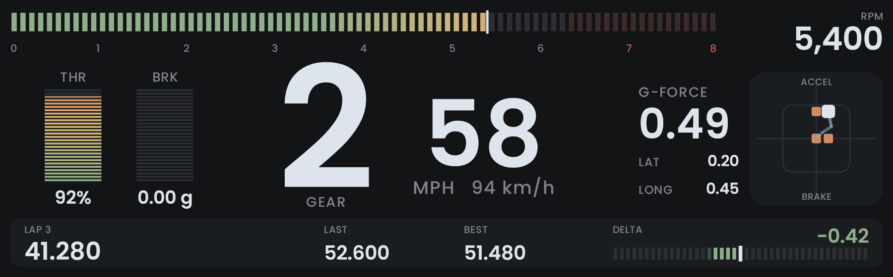
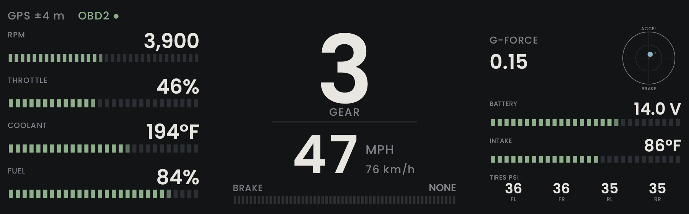
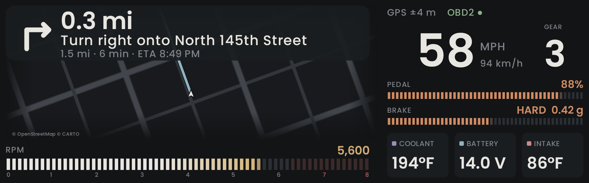
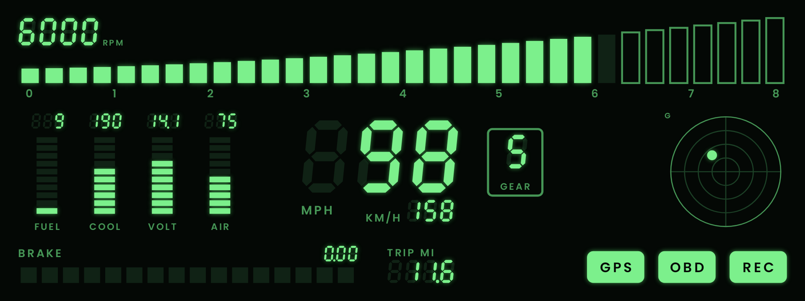
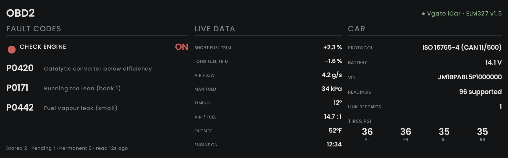
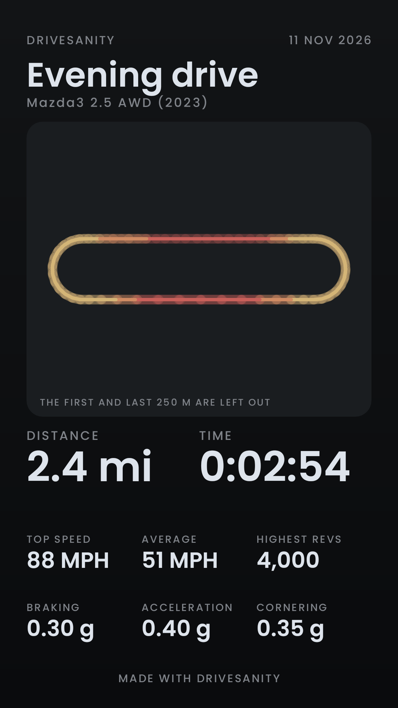

# DriveSanity

Live driving data on your phone and on your car's Android Auto screen: speed, braking,
g-force, RPM, gear, fuel economy and engine temperatures.

## Install

Pick the one that matches what you want. Both start by downloading the app:

**[Download DriveSanity.apk](https://github.com/byjoelsamuel/DriveSanity/releases/latest/download/DriveSanity.apk)**
(open this link on your phone).

### Just on the phone

1. Open the downloaded file and tap **Install**. If Android asks, allow your browser or
   Files app to install unknown apps.
2. Open DriveSanity and allow location.

That's all. The car screen won't show up this way.

### On the phone and in the car (Android Auto)

Android Auto only lists apps that were installed from Google Play, so a normal install
doesn't appear in the car. [UnknownAuto](https://github.com/GitMag/UnknownAuto/releases) installs the
app so Android Auto accepts it. It needs a helper app called **Shizuku**, which you set up once.

**Set up once** (about five minutes, Android 11 or newer, needs Wi-Fi but not internet):

1. Install **UnknownAuto**. Open it and allow it to install unknown apps when it asks.
2. In UnknownAuto, tap **Install Shizuku**, or get Shizuku from Google Play.
3. Turn on Developer options: Settings → About phone → tap **Build number** seven times.
4. Open Shizuku and, under **Start via Wireless debugging**, tap **Pairing**. Allow
   notifications.
5. Open Settings → Developer options → **Wireless debugging**, turn it on, then tap
   **Pair device with pairing code**. Leave that box open.
6. Pull down the notification from Shizuku, tap **Enter pairing code**, and type the six
   digits.
7. Back in Shizuku, tap **Start**. The screen should say **Shizuku is running**.

**Install DriveSanity:**

1. Open UnknownAuto → **Load APK or XAPK…** → pick the `DriveSanity.apk` you downloaded.
2. Tap **Install DriveSanity for Android Auto** and confirm. The first time, Shizuku asks to
   let UnknownAuto in: choose **Allow all the time**.
3. UnknownAuto shows a green tick when Android Auto will accept the app.
4. Open Android Auto on the car screen. DriveSanity is in the app list.

### Updating

New versions are on the [Releases page](https://github.com/byjoelsamuel/DriveSanity/releases).
The app doesn't update itself.

1. Download the new `DriveSanity.apk` from the same link as above.
2. Install it the same way you did the first time (UnknownAuto, if you use the car screen).
   It installs over the old one and keeps your settings.

After a phone restart, Shizuku has to be started again before you can install: turn
**Wireless debugging** back on and tap **Start** in Shizuku. No new code is needed.

### Phone settings that stop the app running

Open **Setup → Phone check**. It lists what the app needs (precise location, notifications,
Nearby devices for Bluetooth, and battery set to unrestricted), ticks what's fine, and has a
button to fix each thing that isn't. It also says whether the app was installed with the Play
mark that Android Auto wants. Phone makers add their own battery savers on top of Android's, so
the check shows steps for Samsung, OnePlus, Oppo, Realme, Xiaomi, Huawei and Vivo when it sees
one. The ones that matter most:

- **Samsung:** Settings → Battery → Background usage limits → turn off "Put unused apps to
  sleep" and add DriveSanity to "Never sleeping apps".
- **OnePlus / Oppo / Realme:** Settings → Apps → DriveSanity → Battery usage → "Allow
  background activity", then lock the app in the recent apps view so it isn't cleared.

### If something goes wrong

- **"Installed, but without the Google Play mark"** (red message in UnknownAuto, mentioning
  "installer started as shell"): Shizuku isn't running. Open Shizuku, make sure it says
  **Shizuku is running** (turn on Wireless debugging and tap **Start** if not), then tap
  Install in UnknownAuto again. If you haven't set Shizuku up yet, do the steps above.
- **Shizuku won't pair:** keep the pairing box open, stay on Wi-Fi, allow notifications for
  Shizuku, and set its battery use to unrestricted.
- **Installed fine, but not in the car:** first, the UnknownAuto message must be green. If it
  says "without the Play mark", Shizuku wasn't running (see above). If it's green, try these in
  order:
  1. In Android Auto's settings, tap **Version** about 10 times, open the three-dot menu →
     **Developer settings** and turn on **Unknown sources**.
  2. In Android Auto's settings, open **Customize launcher** and make sure DriveSanity is
     ticked.
  3. Force stop Android Auto (phone Settings → Apps), then reconnect to the car.
  4. Update Android Auto and Google Play services.
  5. Open DriveSanity once on the phone and allow location.
- **Phone says it can't install over the old version:** the old one was installed a different
  way. Uninstall DriveSanity and install it again.
- **Other trouble with UnknownAuto:** its own page has more help.

## First drive

1. Mount the phone firmly, facing you or lying flat with its top pointing forward.
2. Stop on level ground and tap **Calibrate** (Drive tab, or in Setup). The app uses this to
   find which way is forward. Do it again if you move the mount.
3. Drive. To record, tap **Start recording** on the Drive tab. Recordings show up in **Trips**:
   tap one to see its path, graphs and laps, or share it as a spreadsheet (CSV).

Without an OBD2 adapter you still get speed, braking, g-force and trip stats.

**No car handy?** **Setup → Demo and raw recordings → Start demo** plays a made-up drive
through the whole app (all the screens, the car screen, the lap timer), so you can try
everything first.

## The screens

The phone app has four tabs: **Drive**, **Track** (lap timer and standing starts), **Trips**
(your recordings) and **Setup**. The car shows one of five
full-screen dashboards. Pick it in Setup → Car screen, or with the buttons at the top of the
car screen.

**Gauges**: bar gauges for RPM, throttle, coolant and fuel (or economy) on the left, a huge
gear and the speed in the middle, g-force, battery, intake air and tires on the right.

**Map**: the map takes more than half the screen, with the next turn in a big box over its top
edge and the rev bar underneath. On the right: speed and gear, how hard the accelerator and the
brake are pressed, and coolant, battery and intake air.

**Sport**: laid out like a race car's display, for driving hard. A long rev ribbon across the top
fills towards the redline, holds a thin marker at your highest recent revs and flashes at the
shift point. In the middle are the gear and the speed, as big as they'll go. Throttle and brake
are two tall pedal bars on the left, like the pedal traces on a racing display. On the right is a
g-g plot: a dot for the car's g-force with a trail, and a mark where your hardest braking,
acceleration and corners have been. Along the bottom is the lap timer with a delta bar against
your best lap, or your last standing-start times, or air/fuel, load, coolant, top speed and peak
g when neither is running. It's the top-row button **SPORT** in the car, and on that screen the
first button becomes **Set line** / **End laps**.

**Retro**: everything in Saab green, after early-2000s dashboards.

**OBD2**: the check-engine lamp, fault codes, live engine readings and facts about the car.
For parked moments.

Speed counts up and down smoothly, with digits that roll like an odometer. The map screen
also shows the speed limit.

*The map picture was made where the map server can't be reached, so its streets are a
stand-in. In the app the map is the real OpenStreetMap.*

The bars are rows of thin, close-set ticks, like the bars on an old LED tachometer, and the one
a reading is partway through fades in so they fill smoothly. Everything is set in Poppins.

Everything glides: bars and numbers ease to their new values between readings instead of
jumping, and the car screen redraws about 30 times a second.

## Lap timer and standing starts

On the **Track** tab (or the **Set line** button on the car's Sport screen):

1. Drive to the spot you want as the start/finish line and tap **Set start/finish line here**
   while moving. The line goes across the road where you are, in the direction you're heading.
   Lines are saved by name.
2. Cross it. The first crossing starts the clock; every crossing after that is a lap. Laps are
   timed between GPS fixes, to a few hundredths of a second, and a quick bounce back over the
   line is ignored.
3. The Sport screen shows the current lap, the last and best laps, and a delta bar: left of the
   middle is faster than your best lap so far, right is slower. The **Track** tab lists every lap.

Lap timing records the drive at one row a second, so the laps are saved in **Trips** afterwards.

**Standing start:** stop the car, then launch. 0–60 mph, 0–100 km/h and the quarter mile with its
trap speed are timed on their own, from the car's speed when the adapter is connected (a lot
better than GPS for this) and from GPS when it isn't. They show on the Track tab and the Sport
screen. The start is worked out from the moment the speed first rises, so a slow first reading
doesn't cost you time.

Phone GPS gives one fix a second, which limits lap timing; it's fine for finding a rough lap
time and a delta, not for settling a tenth of a second. An external GPS would be better.

## Trips and recordings

Every recording is a spreadsheet (CSV) with a row **every five seconds**, plus an extra row
(never more than one a second) the moment something happens: speed changes by 10 km/h, you turn
15 degrees, or you pull 0.35 g. Each row also carries the hardest braking, acceleration and
cornering and the highest revs since the last row, so a hard stop between two rows isn't lost.
That's about 100 KB an hour, instead of several MB at ten rows a second. While lap timing runs it
writes a row every second, because laps need it.

Tap a recording in **Trips** to see its distance, time, top and average speed, peaks, the path
drawn on a plain map and coloured by speed, speed and revs against time with a scrubber you drag
along the drive, and the laps. Older recordings still open.

## Sharing to Instagram

Open a recording in **Trips** and scroll to **Share**. The app draws a picture of the drive on your
phone (nothing is uploaded) in two shapes: **Story** (9:16) and **Post** (4:5, for the feed).

- **The drive:** the shape of the path coloured by speed, distance, time, top and average speed,
  highest revs, and your hardest braking, acceleration and cornering.
- **The laps** (when you timed some): your best lap big, and every lap as a bar.
- **A standing start:** on the **Track** tab, **Make a picture** under *Standing start* gives 0–60,
  0–100 km/h and the quarter mile with its trap speed.

**Instagram** opens Instagram with the picture, which then asks whether it's for a Story, a post or
a message; **Share…** sends it to any app; **Save** puts it in Pictures/DriveSanity (Android 10 or
newer). I haven't registered the app with Meta, so there's no one-tap "Add to Story" sticker
button; Instagram's own chooser does the job.

**Your home stays off it.** Drives usually start and end at home, so the first and last 250 m of the
path are left out by default (a drive under 750 m shows no path at all), and the picture has no map
tiles, street names or coordinates, only the shape. **Show the whole path** is there if you want it.

(Apps like MEZGR share a link to a page of the drive. That needs a server to host the pages, so this
sends a picture instead.)

## Demo mode and raw recordings

**Setup → Demo and raw recordings → Start demo** plays a made-up drive in place of the real car,
GPS and motion sensor: a standing start and three laps of a loop, with the Mazda3's gears, revs,
g-forces and a lap timer already armed. It runs every screen and the car screen too. (It's a
simulation, built by `tools/make_demo.py`; nothing in it is a real person's drive.)

**Record a raw session** writes what the GPS, the motion sensor and the adapter report into one
small file. **Share last** sends it, for a bug report with exactly what the car said, and **Play
it** replays it through the app like a demo. It's off until you start it.

## OBD2

Any ELM327 Bluetooth adapter works, classic or Bluetooth LE. It's what gives RPM, throttle,
temperatures, battery voltage and fault codes.

1. Plug the adapter into the OBD2 port under the dashboard and turn the ignition on.
2. A classic Bluetooth adapter has to be paired in Android's Bluetooth settings first (PIN
   usually 1234 or 0000). Bluetooth LE adapters don't.
3. In the app: **Setup** → **Choose adapter**. You only do this once.

**If it keeps disconnecting**

- Android settings → Apps → DriveSanity → Battery → **Unrestricted**.
- Open the app on the phone before you drive. That starts the notification that keeps the
  link alive when you switch apps or the screen turns off.
- Close other apps that talk to the adapter (its own app, Torque, Car Scanner). Most adapters
  allow one connection at a time.
- **Setup → OBD2 adapter → Diagnostics** shows how often the link restarted and why.
  "Adapter stopped answering" points at the adapter or car; "Adapter disconnected" means
  Bluetooth dropped.

The fault codes are on the OBD2 screen and in **Setup → Fault codes**.

**Read-only.** The app only asks the car questions. Anything that could change something (clearing
fault codes, writing a setting, starting a test, diagnostic sessions, security requests) is blocked
inside the app before it reaches the adapter, and there's a test for that. The extra
manufacturer-specific reads used to look for fuel level and tire pressure are still only reads, and
they're **off until you turn them on** in Setup.

**Letting the car sleep.** A car that's being asked questions can't go to sleep, which drains the
battery and can stop a dashcam from going into parking mode. So once the engine has been off for a
little while (20 seconds if the car stops answering, two minutes if it's on but not running), the
app stops asking and only reads the adapter's own voltage, which doesn't touch the car. It wakes
when you open the app, the car connects to Android Auto, you drive off, or the voltage shows the
engine running. If the car isn't answering when the app connects, it waits longer between tries,
up to two minutes, instead of asking every few seconds. It's on by default; **Setup → Read-only,
and the car's battery** turns it off. If the car sits for days, unplug the adapter anyway: cheap
adapters keep drawing a little current.

## Your car

Pick your car in **Setup → My car**. It decides how the gear is worked out and where the red
zone starts.

| Car | Gears | Redline |
|---|---|---|
| Mazda3 2.5 AWD (2023), 6-speed automatic | Known: ratios from Mazda's spec sheet | 6,300 rpm |
| Hyundai Alcazar 1.5 turbo petrol, 6-speed manual or 7-speed DCT | Learned while you drive | A guess: 6,000 rpm |
| Hyundai Alcazar 1.5 diesel, 6-speed manual or 6-speed automatic | Learned while you drive | A guess: 4,800 rpm |
| Honda Amaze 1.2 petrol, 5-speed manual | Learned while you drive | A guess: 6,600 rpm |
| Honda Amaze 1.2 petrol, CVT | None: it shows CVT | A guess: 6,600 rpm |

- **Learned gears:** the app watches speed against RPM and sorts it into gears. Drive through
  the gears for a few minutes and the gear number appears. It's remembered per car.
- **Redlines marked "a guess"** are only a starting point. Use **−** and **+** under Redline
  to match your tachometer.
- If you have exact gear ratios and the final drive, they can go into `CarProfiles` in
  `Cars.kt`.

## Throttle and pedal

Many cars, including newer Mazdas, move the throttle valve themselves to hold the revs, so the
standard "throttle position" reading follows RPM, not your foot. The app asks the car for the
accelerator pedal reading instead (the standard readings for pedal position and relative
throttle), and uses the first one the car has. If the car has none of them, it takes the
throttle valve and rescales it so idle reads 0% and the widest it has opened reads 100%, and
that is only an estimate. **Setup → OBD2 adapter → Diagnostics** says which one is in use
("Pedal reading").

## Fuel, tires and economy

Standard OBD2 data doesn't include fuel level on a 2023 Mazda3, and tire pressures aren't
standard on any car. They need manufacturer-specific requests, and I couldn't find a verified
set for the 2019+ Mazda3. So those two show a dash for now. **Setup → OBD2 adapter → Ask the
car for fuel and tires** sends a few read-only requests used on other Mazdas and shows the raw
replies under Diagnostics. Compare them with the car's own screen to work out the decoding.

**Fuel economy** is estimated instead: the engine's air flow (MAF), divided by the air/fuel
ratio, gives fuel use. Coasting with the fuel cut off counts as zero. It's shown as L/100 km
or MPG, and as litres or gallons per hour when you're stopped. The trip total is in **Trips**.

- It's an estimate, a few percent off either way. Use it to compare drives.
- Petrol engines only (the Alcazar diesel is left out), and the car has to report air flow.

## Shift light and alerts

- **Shift light:** the gear turns sand at 92% of the redline, and at 98.5% it flashes red. All
  screens except Retro also get a thin strip along the top that does the same. The redline is
  set per car in Setup.
- **Alerts:** a banner for a hot engine (above 108 °C / 226 °F), low battery (under 11.8 V, or
  12.5 V with the engine running), a flat tire (under 27 psi), low fuel when the car reports
  it, and going 5 mph (8 km/h) over the posted limit.
- Both are visual only, and both can be turned off in **Setup → Alerts and shift light**.

## Startup animation and sound

The app opens with a soft old-TV power-on: a glowing line swells until light fills the
screen and the name fades in. It plays on the phone, and in the car when Android Auto
connects. Tap to skip, or turn it off in Setup.

A short rising chime plays with it, then a Japanese voice says "ETC card inserted", like the
reader at a toll gate. Choose Off, Chime, Voice or **My file** in **Setup → Startup sound**.

- The chime is a sound I made for the app, not a recording of a real ETC reader (those are
  copyrighted).
- The voice is your phone's own Japanese text-to-speech. If none is installed you get just
  the chime.

## The map

**Look:** Setup → Map look. *Modern* (the default) is CARTO's dark map, already styled for a
dashboard and fetched at double resolution so it's sharp on the car screen. *Classic* is the
standard OpenStreetMap map turned dark, as before. Both need mobile data, and both are credited
on the map.

**On the phone**, tap **Where to?** on the Drive tab and type an address.

**On the car screen**, show the Map screen and tap the magnifying glass over the map. Android
Auto opens its keyboard (only while you're parked) and a microphone, so you can type or say the
place. Pick a result and the route starts. The same screen has **End route**. The app only
looks the place up when you submit it, not on every letter, because the free address service
doesn't allow search-as-you-type.

**By voice through the Assistant**, "navigate to …" can hand a place to the app when it's
chosen as the navigation app. Whether your car and Assistant offer DriveSanity for that depends
on Android Auto, so treat it as a bonus.

The car then shows turn-by-turn directions with distance, time left and arrival time, and
finds a new route if you leave the planned one.

- **Map:** OpenStreetMap, dark and turning with the car. It needs mobile data.
- **Speed limit:** from OpenStreetMap. Many roads don't have theirs mapped, so the sign only
  shows where one is known.
- **Gear:** most cars don't report gear over OBD2, so it's worked out from speed and RPM. It
  shows a dash while shifting.

The free services below ask apps to keep traffic light, so they suit personal use.

| Service | Used for |
|---|---|
| [OpenStreetMap tiles](https://www.openstreetmap.org) | The map |
| [Nominatim](https://nominatim.org) | Address search |
| [OSRM, run by FOSSGIS](https://routing.openstreetmap.de) | Directions |
| [Overpass API](https://overpass-api.de) | Speed limits |

Map data © OpenStreetMap contributors.

## Things to know

- Hills show up as a small amount of acceleration, because the motion sensor can't tell a
  slope from speeding up.
- Speed comes from the car (OBD2) when the adapter is connected, since it updates several
  times a second, and from GPS (once a second) when it isn't.
- Keep your eyes on the road. The car screen is made for quick glances.

## For developers

Every change goes through a pull request. When it's merged into `main`, GitHub Actions runs
the tests, builds the app, signs it and publishes it as a release. To publish a new version,
raise `appVersion` in `gradle.properties` before merging. Signing uses four repository
secrets: `ANDROID_KEYSTORE_BASE64`, `ANDROID_KEYSTORE_PASSWORD`, `ANDROID_KEY_ALIAS` and
`ANDROID_KEY_PASSWORD`.

To build it yourself, open the project in Android Studio, or run `./gradlew assembleDebug`
with JDK 17 and the Android SDK. `./gradlew testDebugUnitTest` runs the tests.

| Folder or file | What's in it |
|---|---|
| `DriveMath.kt` | Calibration, braking levels and trip stats |
| `DriveEngine.kt` | Reads GPS and the motion sensor |
| `DashPainter.kt`, `ClusterPainter.kt` | Draw the dashboards for the phone and the car |
| `MainActivity.kt`, `ui/` | The phone app (Jetpack Compose) |
| `car/` | The Android Auto screen |
| `obd/` | The OBD2 Bluetooth connection |
| `map/`, `nav/` | Map tiles, address search, directions and speed limits |

The built-in demo drive comes from `tools/make_demo.py`; run it to rebuild `demo.dsr`. The tests
include one that plays the whole demo through the app (`DemoFlowTest`) and checks the laps, the
delta and the standing start come out.

The font is [Poppins](https://fonts.google.com/specimen/Poppins), used under the SIL Open Font
License (see `licenses/Poppins-OFL.txt`).
