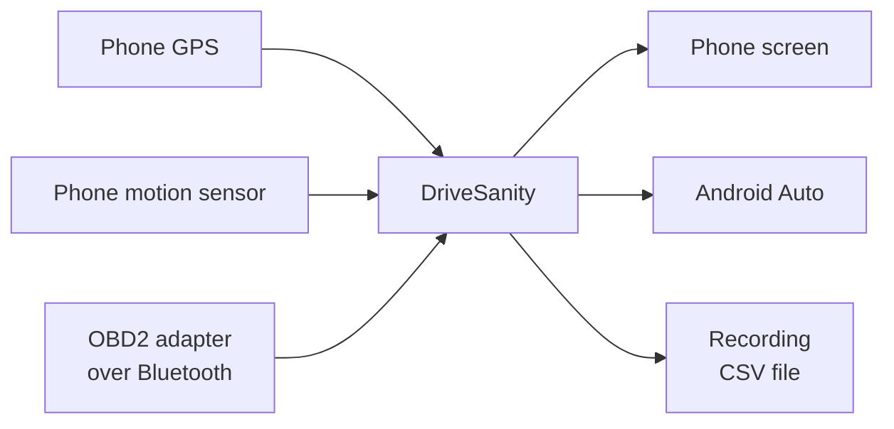
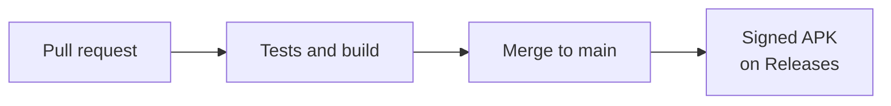

# DriveSanity

An Android app that shows live driving data on your phone and on your car's
Android Auto screen: speed, braking, g-force, RPM, fuel economy and engine temperatures.

The phone and the car each get their own view:

- **On the phone**, a regular app with three tabs: **Drive** (live numbers in plain words),
  **Trips** (this trip's stats and your recordings) and **Setup** (calibration, OBD2, units,
  and which screen the car shows).
- **In the car**, a full-screen dashboard. Pick one of five in Setup → Car screen, or with the
  buttons at the top of the car screen:

**Gauges**: a digital cluster. Bar gauges for RPM, throttle, coolant and fuel on the left, a huge
gear number and the speed in the middle, g-force, battery, intake air and tire pressures on the
right. No round dials.

**Map**: directions in their own box and a live map that fades into the background take the left
half. Speed, gear, RPM, brake and the rest are on the right.

*This picture was made where the map server can't be reached, so its streets are a stand-in.
In the app the map is the real OpenStreetMap.*

**Sport**: laid out like a supercar's digital cluster. The gear is the biggest thing on the screen,
with a thin rev line under it that turns red at the redline. Fuel economy sits top left with a
small arc, then air/fuel ratio and coolant under it, each with a bar that ends in an arrowhead.
Throttle, brake and g-force are on the right the same way, and the four tire pressures run down
the edge in rings. Battery and intake air are in the line along the top. It's the top-row
button **SPORT** in the car, and **Exit Sport** takes you back.

**Retro**: everything in Saab green, after early-2000s dashboards.

**OBD2**: the check-engine lamp, fault codes, live engine readings and facts about the car and
the adapter. For parked moments.

## What you see

- **Speed** in MPH, with km/h underneath. The number counts up and down smoothly and its digits
  roll like an odometer, with a motion smear while it's changing fast.
- **Brake**: how hard you're braking, from light to very hard.
- **RPM** and **throttle**, as bars that go from green to sand to red toward the 6,300 rpm redline.
- **Coolant, fuel, battery and intake air**, as bars or boxes. Coolant shows blue while the engine
  is cold.
- **Gear**, worked out from speed and RPM.
- **Fuel economy**, an estimate (see below).
- **G-force**, a dot that moves when you speed up, brake or turn.
- **Tire pressures**, once the car can tell us (see below).

The map screen adds directions, a live map and the speed limit.

The phone also shows trip stats: distance, average and top speed, peak g-force, and a count
of hard brakes, launches and turns.

## How it works

| Data | Comes from |
|---|---|
| Speed | Phone GPS. If GPS drops out, for example in a tunnel, the car's own speed from OBD2 |
| Braking and g-force | The phone's motion sensor |
| RPM, throttle, temperatures, battery | The OBD2 adapter |
| Fault codes and the OBD2 screen's readings | The OBD2 adapter |
| Gear | Worked out from speed and RPM (see below) |
| Map, routes, address search, speed limits | OpenStreetMap, through free public services |

Without an OBD2 adapter you still get speed, braking, g-force and trip stats.

## Getting started

1. Download [`DriveSanity.apk`](https://github.com/byjoelsamuel/DriveSanity/releases/latest/download/DriveSanity.apk)
   and install it. Allow location when it asks.
2. Mount your phone firmly, either facing you or lying flat with its top pointing to the
   front of the car.
3. Stop on level ground and tap **Calibrate** (on the Drive tab the first time, or in Setup).
   The app uses this to work out which way is forward. Do it again if you move the mount.
4. Drive.

To record a drive, tap **Start recording** on the Drive tab. Recordings appear in **Trips**,
where you can share them as a CSV file or delete them.

## Connecting OBD2

Any ELM327 Bluetooth adapter works, whether it's classic Bluetooth or Bluetooth LE.

1. Plug the adapter into the OBD2 port under the dashboard and turn the ignition on.
2. If it's a classic Bluetooth adapter, pair it in your phone's Bluetooth settings first.
   The PIN is usually 1234 or 0000. Bluetooth LE adapters don't need pairing.
3. In the app, go to **Setup** → **Choose adapter** and pick it from the list.

You only do this once. After that the app connects by itself whenever it's open. Some cars
don't report fuel level; if yours doesn't, the fuel meter will say so.

**If it keeps disconnecting**

- Open Android's settings → Apps → DriveSanity → Battery and choose **Unrestricted**, so Android
  doesn't pause the app while you drive.
- Open the app on the phone once before you drive. That starts the notification that keeps the
  link going when you switch apps or the screen turns off. It stops a few minutes after the
  car goes quiet.
- Close any other app that talks to the adapter (the adapter's own app, Torque, Car Scanner).
  Most adapters only allow one connection at a time.
- **Setup → OBD2 adapter → Diagnostics** shows how many times the link restarted and why.
  "Adapter stopped answering" points at the adapter or the car; "Adapter disconnected" means
  Bluetooth dropped.

## Your car

Pick your car in **Setup → My car**. It decides how the gear is worked out and where the red
zone starts on the rev bar.

| Car | Gears | Redline |
|---|---|---|
| Mazda3 2.5 AWD (2023), 6-speed automatic | Known: ratios and final drive from Mazda's spec sheet | 6,300 rpm |
| Hyundai Alcazar 1.5 turbo petrol, 6-speed manual or 7-speed DCT | Learned while you drive | A guess: 6,000 rpm (peak power is at 5,500) |
| Hyundai Alcazar 1.5 diesel, 6-speed manual or 6-speed automatic | Learned while you drive | A guess: 4,800 rpm (peak power is at 4,000) |
| Honda Amaze 1.2 petrol, 5-speed manual | Learned while you drive | A guess: 6,600 rpm (peak power is at 6,000) |
| Honda Amaze 1.2 petrol, CVT | None: it shows CVT | A guess: 6,600 rpm |

- **Learned gears:** neither Hyundai nor Honda publishes its gear ratios where I could find
  them, so for those cars the app watches speed against RPM and sorts it into gears. Drive
  through the gears for a few minutes and the gear number appears. The learning is kept
  separately for each car.
- **Redlines marked "a guess"** are only a starting point. Use the **−** and **+** under
  Redline to match the red zone on your tachometer; it's remembered for each car.
- **Exact gear ratios:** if you have them and the final drive from the owner's manual, they can
  go into `CarProfiles` in `Cars.kt`, and the gear shows straight away.

## Fuel level and tire pressure

Your car's standard OBD2 data doesn't include these. A 2023 Mazda3 doesn't list the standard
fuel-level reading, and tire pressures aren't part of the standard data on any car. They live in
the car's own modules and need manufacturer-specific requests, which differ from model to model.
I couldn't find a verified set for the 2019+ Mazda3.

So the fuel gauge and the tire readouts show a dash until that's sorted out. To help with it,
**Setup → OBD2 adapter → Ask the car for fuel and tires** sends a handful of read-only
requests that people have used on other Mazdas, and shows the raw replies under Diagnostics.
Compare them with the numbers the car's own screen shows (fuel in the cluster, tire pressures in
Information → Vehicle Status Monitor) and the right decoding can be filled in.

## Fuel economy

The car doesn't give us its fuel level (see above), so the app estimates how much fuel the
engine is using instead. It takes the air flow the engine reports (MAF), divides by the
air/fuel ratio (14.7 to 1 for petrol, adjusted by the lambda reading when the car gives one) and
turns that into litres. Then it shows litres per 100 km or MPG, or litres per hour when you're
stopped. Coasting with the fuel cut off is counted as zero. The trip total is in **Trips**, and
resetting the trip resets it.

- It's an estimate. It runs a few percent off in either direction, so use it to compare drives,
  not to settle an argument with the fuel pump.
- It's for petrol engines. The Alcazar diesel is left out because the air/fuel maths is different.
- It needs the car to report air flow. If yours doesn't, the economy shows a dash.
- If the car's fuel level ever gets decoded (the Diagnostics button above), it will take the
  fuel gauge's place on the Gauges screen. Until then economy sits there.

## Shift light and alerts

- **Shift light:** on the Sport screen the rev line under the gear turns sand at 92% of the
  redline, and at 98.5% the line and the gear flash red. The other screens get a thin strip
  along the top. The redline is set per car in Setup.
- **Alerts:** a banner appears over the screen for a hot engine (above 108 °C / 226 °F), low
  battery voltage (under 11.8 V, or under 12.5 V with the engine running), a flat tire (under
  27 psi), low fuel when the car reports it, and going more than 5 mph (8 km/h) over the posted
  limit when the map knows it. If several are active, the most important shows first.
- Both are visual only, and both can be turned off in **Setup → Alerts and shift light**.

## The OBD2 screen

The fourth car screen. It shows:

- **Fault codes**: whether the check-engine lamp is on, and the stored, pending and permanent
  codes with a short meaning. The app reads them when it connects and every minute while the
  screen is open. **Read codes** at the top of the car screen reads them now. It never clears
  codes.
- **Live data**: short and long fuel trim, air flow, manifold pressure, timing, commanded
  air/fuel ratio, outside temperature and how long the engine has been on. Only the readings
  your car supports appear, and they're only asked for while this screen (or Setup) is open, so
  they don't slow down RPM.
- **Car**: the protocol, battery voltage, VIN, how many readings the car supports, how many
  times the link restarted, and the tire pressures.

The fault codes are also in **Setup → Fault codes** on the phone.

## The startup animation

The app opens with a soft old-TV power-on: a glowing line stretches across the screen, swells
until light fills it, and the name fades in large over the glow. It plays on the phone, and
again in the car when Android Auto connects. Tap to skip, or turn it off in **Setup → Startup
animation**.

## The startup sound

Along with the animation, the app plays a short chime and then says "ETC card inserted" in
Japanese, like the reader at a Japanese toll gate. In the car it plays through the car's
speakers. Pick what you want in **Setup → Startup sound**: Off, Chime, Voice (chime and spoken
line) or My file.

- The chime is a short rising three-note sound I synthesized for this app. It isn't recorded
  from a real ETC reader: those recordings are copyrighted and I couldn't find a free one.
- The spoken line uses your phone's own Japanese text-to-speech voice. If no Japanese voice is
  installed it's skipped and you get just the chime (Android settings → Text-to-speech).
- **My file** lets you pick any audio file from your phone, such as your own recording of the
  real thing.

## The retro screen

Everything is lit in one green on black, like Saab's instrument lighting. The tachometer is a
row of bars that get taller toward the redline, like the C4 Corvette's digital dash, and the
numbers are LCD-style digits with the unlit segments showing faintly. Fuel, coolant, battery
and intake air each get a small bar gauge, and the labels are kept short. There are no colour
warnings on this screen, so warnings blink instead: the tach past the redline, low fuel, a hot
engine and a bad battery voltage.

## The map screen

Pick it in Setup → Car screen, or with the button in the car. On the phone, tap **Where to?**
on the Drive tab and type an address to get directions; the phone then shows a small map
too. Tap **End route** to stop.

- **Map:** OpenStreetMap, shown dark and turning with the car. It needs mobile data. Between
  GPS fixes (about one a second) the car's position is moved on along its heading, so the map
  glides instead of jumping.
- **Directions:** turn by turn, with the distance, time left and arrival time. If you leave the
  route the app finds a new one.
- **Speed limit:** from OpenStreetMap. The app downloads every road with a limit within 1.5 km
  and matches you to the one you're driving along, so the sign changes as soon as you turn.
  Many roads don't have their limit mapped yet, so the sign only shows where one is known.
  Your speed turns orange when you're more than 5 over.
- **Gear:** most cars don't report their gear over OBD2, so the app works it out from speed
  and RPM (see Your car). It shows a dash while shifting, or when the torque converter is
  slipping a lot.

The free services this uses ask apps to keep their traffic light, so they suit personal use.
An app with many users would need its own servers.

| Service | Used for |
|---|---|
| [OpenStreetMap tiles](https://www.openstreetmap.org) | The map |
| [Nominatim](https://nominatim.org) | Address search |
| [OSRM, run by FOSSGIS](https://routing.openstreetmap.de) | Directions |
| [Overpass API](https://overpass-api.de) | Speed limits |

Map data © OpenStreetMap contributors.

## Android Auto

Android Auto only shows apps of this kind if they were installed from Google Play, so a
normal APK install won't appear in the car. Install it with
[UnknownAuto](https://github.com/GitMag/UnknownAuto) instead, which marks the install as
coming from Play. Use UnknownAuto for every update as well.

## Things to know

- Hills show up as a small amount of acceleration, because the motion sensor can't tell a
  slope from speeding up.
- GPS speed updates about once a second.
- Keep your eyes on the road. The car screen is made for quick glances.

## Releases

Every change goes through a pull request. When it's merged into `main`, GitHub Actions runs
the tests, builds the app, signs it and publishes it as a new release.

To publish a new version, raise `appVersion` in `gradle.properties` before merging.
Signing uses four repository secrets: `ANDROID_KEYSTORE_BASE64`,
`ANDROID_KEYSTORE_PASSWORD`, `ANDROID_KEY_ALIAS` and `ANDROID_KEY_PASSWORD`.

## Building it yourself

Open the project in Android Studio, or run `./gradlew assembleDebug` with JDK 17 and the
Android SDK. `./gradlew testDebugUnitTest` runs the tests.

| Folder or file | What's in it |
|---|---|
| `DriveMath.kt` | Calibration, braking levels and trip stats |
| `DriveEngine.kt` | Reads GPS and the motion sensor |
| `DashPainter.kt` | Draws the dashboard for both the phone and the car |
| `MainActivity.kt`, `ui/` | The phone app (Jetpack Compose) |
| `car/` | The Android Auto screen |
| `obd/` | The OBD2 Bluetooth connection |
| `map/` | Map tiles and drawing the map |
| `nav/` | Address search, directions and speed limits |

The font is [Poppins](https://fonts.google.com/specimen/Poppins), used under the SIL Open
Font License (see `licenses/Poppins-OFL.txt`).
