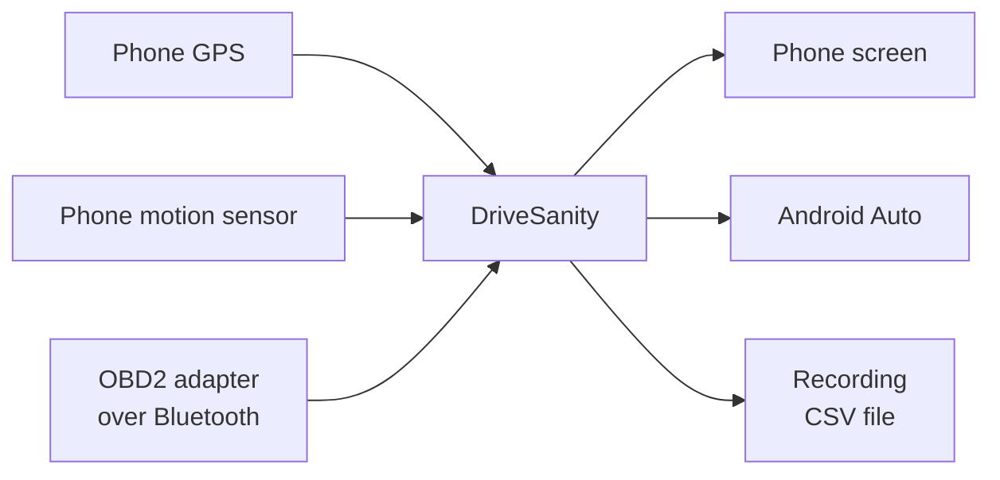
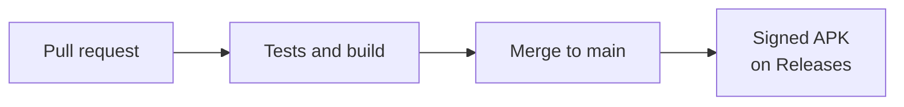

# DriveSanity

An Android app that shows live driving data on your phone and on your car's
Android Auto screen: speed, braking, g-force, RPM, fuel and engine temperatures.

There are three screens. The button that switches them shows the name of the next one.

- **Gauges** (above): the everyday screen.
- **Map:** a map with simple navigation.
- **Retro:** everything in Saab green, after early-2000s dashboards.

## What you see

- **Speed** in MPH, with km/h underneath.
- **Brake**: how hard you're braking, from light to very hard.
- **RPM**: a bar that goes from white to sand to red as you near the 6,300 rpm redline.
- **G-meter**: a dot that moves when you speed up, brake or turn.
- **Fuel**: how much is left in the tank.
- **Four boxes**: coolant temperature, intake air temperature, battery voltage and trip distance.

The map screen swaps the g-meter for a map, and shows the gear you're in, the speed limit
and the next turn when you're navigating.

The phone also shows trip stats: distance, average and top speed, peak g-force, and a count
of hard brakes, launches and turns.

## How it works

| Data | Comes from |
|---|---|
| Speed | Phone GPS. If GPS drops out, for example in a tunnel, the car's own speed from OBD2 |
| Braking and g-force | The phone's motion sensor |
| RPM, fuel, temperatures, battery | The OBD2 adapter |
| Gear | Worked out from speed and RPM (see below) |
| Map, routes, address search, speed limits | OpenStreetMap, through free public services |

Without an OBD2 adapter you still get speed, braking, g-force and trip stats.

## Getting started

1. Download [`DriveSanity.apk`](https://github.com/byjoelsamuel/DriveSanity/releases/latest/download/DriveSanity.apk)
   and install it. Allow location when it asks.
2. Mount your phone firmly, either facing you or lying flat with its top pointing to the
   front of the car.
3. Stop on level ground and tap **Calibrate**. The app uses this to work out which way is
   forward. Do it again if you move the mount.
4. Drive.

To record a drive, tap **Rec**, then **Share** afterwards to send the CSV file.

## Connecting OBD2

Any ELM327 Bluetooth adapter works, whether it's classic Bluetooth or Bluetooth LE.

1. Plug the adapter into the OBD2 port under the dashboard and turn the ignition on.
2. If it's a classic Bluetooth adapter, pair it in your phone's Bluetooth settings first.
   The PIN is usually 1234 or 0000. Bluetooth LE adapters don't need pairing.
3. In the app, tap **OBD2** and choose your adapter.

You only do this once. After that the app connects by itself whenever it's open. Some cars
don't report fuel level; if yours doesn't, the fuel meter will say so.

## The retro screen

Everything is lit in one green on black, like Saab's instrument lighting. The tachometer is a
row of bars that get taller toward the redline, like the C4 Corvette's digital dash, and the
numbers are LCD-style digits with the unlit segments showing faintly. Fuel, coolant, battery
and intake air each get a small bar gauge, and the labels are kept short. There are no colour
warnings on this screen, so warnings blink instead: the tach past the redline, low fuel, a hot
engine and a bad battery voltage.

## The map screen

Switch to it with the screen button on the phone or in the car. Tap **Navigate** on the phone
and type an address to get directions; tap it again to end the route.

- **Map:** OpenStreetMap, shown dark and turning with the car. It needs mobile data.
- **Directions:** turn by turn, with the distance and time left. If you leave the route the
  app finds a new one.
- **Speed limit:** from OpenStreetMap. Many roads don't have their limit mapped yet, so the
  sign only shows where one is known. Your speed turns orange when you're more than 5 over.
- **Gear:** most cars don't report their gear over OBD2, so the app learns it. Each gear has
  its own ratio of speed to RPM, and after a few minutes of driving through the gears the app
  knows which is which. It shows a dash until then, or when the clutch is in.

The free services this uses ask apps to keep their traffic light, so they suit personal use.
An app with many users would need its own servers.

| Service | Used for |
|---|---|
| [OpenStreetMap tiles](https://www.openstreetmap.org) | The map |
| [Nominatim](https://nominatim.org) | Address search |
| [OSRM, run by FOSSGIS](https://routing.openstreetmap.de) | Directions |
| [Overpass API](https://overpass-api.de) | Speed limits |

Map data © OpenStreetMap contributors.

## Android Auto

Android Auto only shows apps of this kind if they were installed from Google Play, so a
normal APK install won't appear in the car. Install it with
[UnknownAuto](https://github.com/GitMag/UnknownAuto) instead, which marks the install as
coming from Play. Use UnknownAuto for every update as well.

## Things to know

- Hills show up as a small amount of acceleration, because the motion sensor can't tell a
  slope from speeding up.
- GPS speed updates about once a second.
- Keep your eyes on the road. The car screen is made for quick glances.

## Releases

Every change goes through a pull request. When it's merged into `main`, GitHub Actions runs
the tests, builds the app, signs it and publishes it as a new release.

To publish a new version, raise `appVersion` in `gradle.properties` before merging.
Signing uses four repository secrets: `ANDROID_KEYSTORE_BASE64`,
`ANDROID_KEYSTORE_PASSWORD`, `ANDROID_KEY_ALIAS` and `ANDROID_KEY_PASSWORD`.

## Building it yourself

Open the project in Android Studio, or run `./gradlew assembleDebug` with JDK 17 and the
Android SDK. `./gradlew testDebugUnitTest` runs the tests.

| Folder or file | What's in it |
|---|---|
| `DriveMath.kt` | Calibration, braking levels and trip stats |
| `DriveEngine.kt` | Reads GPS and the motion sensor |
| `DashPainter.kt` | Draws the dashboard for both the phone and the car |
| `MainActivity.kt` | The phone screen |
| `car/` | The Android Auto screen |
| `obd/` | The OBD2 Bluetooth connection |
| `map/` | Map tiles and drawing the map |
| `nav/` | Address search, directions and speed limits |

The font is [Poppins](https://fonts.google.com/specimen/Poppins), used under the SIL Open
Font License (see `licenses/Poppins-OFL.txt`).
